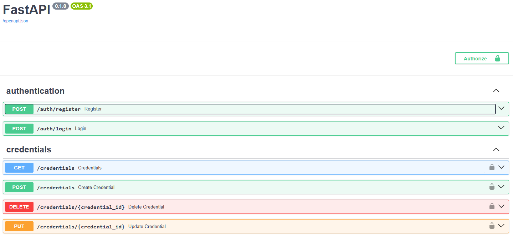

# VaultAPI

VaultAPI is a FastAPI credential manager backed by SQLite. It supports account
registration and login, and lets each authenticated user manage their own
credentials.

## Project layout

```text
main.py                 FastAPI app setup and router registration
routes/auth.py          Registration, login, and login rate limiting
routes/credentials.py   Authenticated credential endpoints
auth_service.py         Registration and password verification logic
auth_tokens.py          JWT creation and verification
credential_crypto.py    Encryption for stored credential passwords
database.py             SQLite schema and database operations
security.py             Argon2 password hashing
```

## Security configuration

The API requires two keys in environment variables. Never commit or share them.

- `VAULTAPI_JWT_SECRET` signs access tokens. It must be a random secret of at
  least 32 bytes.
- `VAULTAPI_CREDENTIAL_ENCRYPTION_KEY` encrypts credential passwords in the
  SQLite database using Fernet.

Generate each key once, store it in a secure secret store, and reuse the same
value every time the application starts. Losing or changing the credential
encryption key means encrypted passwords cannot be opened. Do not print either
key or store it in the database. For production, use a dedicated secret
manager rather than a development shell setup.

For a local PowerShell environment, the following setup creates each key only
if it is not already stored for the current Windows user, and makes it
available in the current shell without displaying its value:

```powershell
$jwtSecret = [Environment]::GetEnvironmentVariable("VAULTAPI_JWT_SECRET", "User")
if (-not $jwtSecret) {
    $jwtSecret = python -c "import secrets; print(secrets.token_urlsafe(32))"
    [Environment]::SetEnvironmentVariable("VAULTAPI_JWT_SECRET", $jwtSecret, "User")
}
$env:VAULTAPI_JWT_SECRET = $jwtSecret

$credentialKey = [Environment]::GetEnvironmentVariable("VAULTAPI_CREDENTIAL_ENCRYPTION_KEY", "User")
if (-not $credentialKey) {
    $credentialKey = python -c "from cryptography.fernet import Fernet; print(Fernet.generate_key().decode())"
    [Environment]::SetEnvironmentVariable("VAULTAPI_CREDENTIAL_ENCRYPTION_KEY", $credentialKey, "User")
}
$env:VAULTAPI_CREDENTIAL_ENCRYPTION_KEY = $credentialKey
Remove-Variable jwtSecret, credentialKey
```

`VAULTAPI_ACCESS_TOKEN_MINUTES` controls token lifetime. It defaults to 30
minutes and must be a positive integer.

Credential passwords are encrypted when created or updated. Existing database
rows are not automatically migrated; a legacy value is encrypted when that
credential is updated. Credential responses decrypt the password for its
authenticated owner.

## Run the API

Install dependencies and start the development server:

```powershell
uv sync
uv run uvicorn main:app --reload
```

The default Uvicorn configuration listens on the local computer. Open
[http://127.0.0.1:8000/docs](http://127.0.0.1:8000/docs) for Swagger UI.

## API endpoints

| Method | Endpoint | Purpose |
|---|---|---|
| `POST` | `/auth/register` | Register an account |
| `POST` | `/auth/login` | Log in and receive a JWT access token |
| `GET` | `/credentials` | List the authenticated user's credentials |
| `POST` | `/credentials` | Add a credential for the authenticated user |
| `PUT` | `/credentials/{credential_id}` | Update an owned credential |
| `DELETE` | `/credentials/{credential_id}` | Delete an owned credential |

<!-- Save a Swagger UI screenshot as docs/images/swagger-ui.png before publishing. -->


### Register

Send `POST /auth/register` with JSON:

```json
{
  "username": "Ari",
  "email": "ari@example.com",
  "password": "choose-a-password"
}
```

A successful request returns HTTP 201 and the public account fields (`id`,
`username`, and `email`). The password is hashed with Argon2; neither the
password nor its hash is returned. A duplicate email returns HTTP 409.

### Log in and authorize Swagger

Send `POST /auth/login` with JSON:

```json
{
  "email": "ari@example.com",
  "password": "choose-a-password"
}
```

The response contains `access_token`, `token_type: "bearer"`, and public user
fields. The JWT uses HS256, a string user ID in its `sub` claim, and an
expiration time. Invalid credentials return HTTP 401.

In Swagger UI, execute the login endpoint, copy `access_token`, click
**Authorize**, and paste the token. Swagger will attach it to subsequent
credential requests until it expires. The API returns HTTP 401 for missing or
invalid tokens.

### Credential access

All credential endpoints require a Bearer token. A user can only list, update,
or delete their own credentials. Other users receive an empty list or HTTP 404
for credentials they do not own.

### Login rate limiting

Five failed login attempts from one IP within 15 minutes trigger HTTP 429 with
a `Retry-After` header. A successful login clears that IP's failed attempts.
The current limiter stores counters in process memory: a server restart clears
them, and multiple server workers do not share them. A deployed multi-worker
service should use a shared rate-limit store.

## Automated tests

Install the test dependencies and run pytest:

```powershell
uv sync --extra test
uv run pytest
```

The API tests change into a temporary directory before importing the database
module, so their registration and credential operations use a temporary
`vault.db` rather than the project's database.
